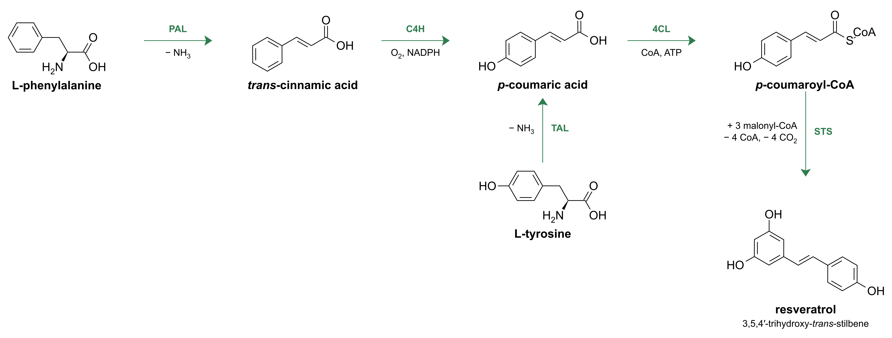

<p align="center"></p>

# ChemFox

A keyboard-first editor for chemical structures and reaction schemes, built for figures in papers,
reports and slides. Native on Windows and macOS, works offline. Chemistry by [RDKit](https://www.rdkit.org).



> **Beta (0.x).** Things will change and there will be bugs. Please
> [report what you find](../../issues/new/choose).
>
> Website and downloads: **[cmfx.trevfox.dev](https://cmfx.trevfox.dev)** · [User guide](https://cmfx.trevfox.dev/guide.html)

## Install

Download the latest build from **[Releases](../../releases)**:

| | File |
| --- | --- |
| Windows 10/11 (64-bit) | `ChemFox-<version>-setup.exe` (or the `.zip` to run without installing) |
| macOS 11+ (Apple silicon: M1 or later) | `ChemFox-<version>-macos-arm64.dmg` |

The test builds aren't code-signed yet, so the first launch needs one extra click:

- **Windows:** if SmartScreen says "Windows protected your PC", click **More info → Run anyway**.
- **macOS:** open the `.dmg` and drag ChemFox to Applications. The first time, **right-click ChemFox → Open → Open**
  (or System Settings → Privacy & Security → **Open Anyway**). If macOS says the app "is damaged", run
  `xattr -dr com.apple.quarantine /Applications/ChemFox.app` in Terminal.

## Getting started

- **Hover and type.** Point at an atom and press `N`, `O`, `S`… to change it, `1`/`2`/`3` to grow a bond,
  `Shift+6` for a ring, `R` for benzene. Point at a bond and press `2` for a double bond, `W`/`H` for wedge/hash.
- **Draw** by dragging from an atom; pick **Chain**, **Arrow** or **Bent** on the left toolbar for the rest.
  Plain drag on empty canvas draws a selection box.
- **Paste a SMILES or InChI** with Ctrl+V (⌘V), or type whole reactions in **Reaction → Reaction Builder**.
- **Arrange** a scheme with Ctrl+Shift+A, line products up with their reactants with Ctrl+Shift+L, and export
  SVG, PDF, PNG or (Windows) EMF from **File → Export**.
- Every key is listed and rebindable in **Edit → Keyboard Shortcuts**; **Help → Keyboard Reference** has a summary.
- Examples are in the `samples` folder (Start menu → ChemFox samples on Windows).

## What's in it

- Drawing with chemistry rules: double-bond placement, flipped labels (CO₂Et ↔ EtO₂C), wedges, abbreviations
  that count toward the formula, expand/collapse labels, R/S and E/Z labels, clean-up with orientation cycling.
- Reaction schemes: six arrow kinds plus bent arrows, conditions with automatic subscripts, compound names and
  numbers, direction-aware layout that can tidy just a selection.
- Reaction Builder: reactions from SMILES/SMARTS rows, automatic atom mapping, broken/formed bonds coloured,
  mapping fixable by dragging; align products to reactants.
- Formula, mass, SMILES, InChI; import MOL/SDF/SMILES/InChI; export SVG (reopenable), PDF, PNG, EMF, MOL.
- Styles (ACS, slides, poster, dark…) editable in a panel; warnings you can silence per item or per document.

See [CHANGELOG.md](CHANGELOG.md) for what changed in each version.

## Privacy

ChemFox runs entirely on your computer and collects nothing: no accounts, no analytics, no telemetry. Your
drawings never leave your machine.

The one exception is the **update check**, which asks GitHub's public releases list whether a newer ChemFox
exists (at most once a day, at startup). It sends nothing about you or your documents beyond what any web
request carries (your IP address, to GitHub). Turn it off in **Help → Check for Updates Automatically**; you
can still check by hand with **Help → Check for Updates**.

## Reporting problems

Use **Help → Report a Problem** in the app, or [open an issue](../../issues/new/choose). The form asks for your
version (Help → About) and system; attaching the `.cmfx` file that shows the problem helps most. Security
problems: please report them privately ([SECURITY.md](SECURITY.md)).

## Contributing

ChemFox is a one-person project and **doesn't accept pull requests**. You're welcome to fork it under the
Apache-2.0 licence. Bug reports are welcome. See [CONTRIBUTING.md](CONTRIBUTING.md).

## Building from source

ChemFox is C++20 with Qt 6 and RDKit; dependencies come from conda-forge (`environment.yml`).

**Windows** (Visual Studio 2022 Build Tools with the C++ workload, plus [micromamba](https://mamba.readthedocs.io)):

```powershell
micromamba create -p ..\.env -f environment.yml
.\build.ps1 -Test            # build and run the tests
.\ChemFox.cmd                # run
.\deploy.ps1 -Installer      # dist\: portable folder, zip and setup.exe (needs Inno Setup 6)
```

**macOS** (Xcode command line tools, plus micromamba):

```bash
micromamba create -n chemfox -f environment.yml && micromamba activate chemfox
packaging/macos/build-mac.sh      # build-mac/bin/ChemFox.app and dist/ChemFox-<version>-macos-<arch>.dmg
```

Headless export, handy for batch figures: `ChemFox --export input.cmfx out.svg --arrange --preset acs`.

[CONTRIBUTING.md](CONTRIBUTING.md) covers the code layout, tests and how releases are made (useful for forks).

## Licence

Apache License 2.0 (see [LICENSE](LICENSE)). ChemFox bundles RDKit (BSD), Qt (LGPL v3, dynamically linked) and
other libraries under their own licences; see [NOTICE](NOTICE) and, in installed copies, the `licenses` folder.
